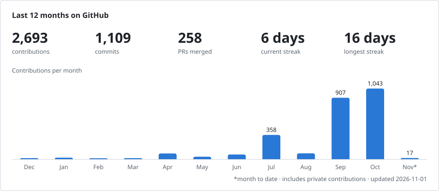
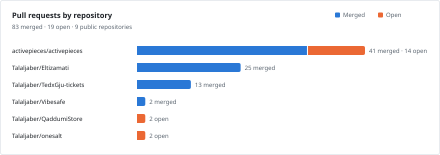
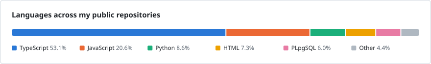

# Talal Jaber

**Software engineer in Amman, Jordan. I take products from the first customer interview to production.**

Founder & CTO of [DineLink](https://dinelink.org) · Software Engineer at [Activepieces](https://www.activepieces.com) · Computer Engineering at GJU

  

---

- 🏆 **Won Falling Walls Lab Jordan 2025** with DineLink, then pitched at the Global Finals in Berlin as one of the Top 100 innovators picked from 2,750+ applicants. I was the youngest finalist there.
- ⚙️ **At Activepieces** I've merged **<!-- AP_MERGED:START -->125<!-- AP_MERGED:END --> pull requests** that redesign the step forms of **<!-- AP_PIECES:START -->88<!-- AP_PIECES:END --> integrations**, including Gmail, Slack, HubSpot, Google Sheets, Notion, OpenAI and Claude.
- 🛡️ **I maintain [VibeSafe](https://github.com/Talaljaber/Vibesafe)**, an open-source scanner that catches leaked secrets and unsafe config in AI-built apps before they ship.
- 📄 **I co-authored HydroSense**, research on low-cost leak detection with AI and IoT that was accepted to ICFT 2026.

🌐 **Live:** [dinelink.org](https://dinelink.org) · [mawa3eed.org](https://mawa3eed.org) · [medmodelle.com](https://medmodelle.com)

## Where I work

| | Role | Since | What I do |
|:--|:--|:--|:--|
|  **[Activepieces](https://www.activepieces.com)** | Software Engineer (part-time, remote) | Sep 2026 | Integrations, UI, output schemas and AI actions for an open-source workflow automation platform |
|  **[DineLink](https://dinelink.org)** | Founder & CTO | Feb 2025 | AI-powered ordering and real-time kitchen sync for restaurants, now in Phase Two of the DITECH Incubation Hub |
| **[Mawa3eed](https://mawa3eed.org)** | Founder | Aug 2026 | Barbershop booking in Palestine: customers book from a WhatsApp link with no app or account. Piloting with 4 salons |
| **Alfredo EdTech** | Software Engineering Intern | Aug 2026 | Internal automation tools and a social media autopilot |
| **GDG Amman** | Technical Lead | Aug 2025 | Workshops and hackathons for a 3,000+ member community |
| **Freelance** | Full-Stack Developer | Feb 2025 | 9+ web apps for small businesses, from discovery calls to deployment |
| **Falling Walls Foundation** | Ambassador, Jordan | Apr 2026 | Speaking and mentoring at the Amman and Ramallah labs |

## Selected work

| Project | What it is | Proof |
|:--|:--|:--|
| 🛡️ **[VibeSafe](https://github.com/Talaljaber/Vibesafe)** | Pre-deploy safety scanner for vibe-coded apps. TypeScript monorepo with a shared core, CLI, VS Code extension and MCP server |   |
| 💳 **[Eltizamati](https://github.com/Talaljaber/Eltizamati)** | Bilingual (Arabic/English) app for tracking loans, Murabaha financing and credit cards, built on a decimal-safe finance engine. React Native + Supabase | 5th place, Rally Fintech Hackathon |
| 💧 **[HydroSense](https://github.com/Talaljaber/HydroSense)** | Detects pipe leaks from acoustic sensor data using DSP features and an ExtraTrees model | 93.4% test accuracy · ICFT 2026 |
| 🎟️ **[TEDxGJU Tickets](https://github.com/Talaljaber/TedxGju-tickets)** | QR ticketing with one-scan validation, an admin dashboard and email delivery | 150+ registrations, no delays at the door |
| 🩺 **[MedModelle](https://medmodelle.com)** | E-commerce store for premium medical scrubs, built end to end for a Jordan-based client. Next.js, NestJS, PostgreSQL | Live at [medmodelle.com](https://medmodelle.com) |
| 🚗 **[Driver Monitor](https://github.com/Talaljaber/driving-monitor)** | Real-time drowsiness detection using MediaPipe face landmarks, signal smoothing and a 3-state alert engine | Python · OpenCV · ONNX |
| 🎮 **[GDG Booth Game](https://github.com/Talaljaber/GDG)** | Live multiplayer mini-games for GDG events, run by a host code on Supabase Realtime | 10 games, no backend |

## Latest merged pull requests

<!-- RECENT_PRS:START -->
- [feat(attack): unauth-route check](https://github.com/Talaljaber/Vibesafe/pull/146) Vibesafe · Oct 30
- [feat(attack): idor check](https://github.com/Talaljaber/Vibesafe/pull/147) Vibesafe · Oct 30
- [feat(attack): HTML report with precision ledger](https://github.com/Talaljaber/Vibesafe/pull/140) Vibesafe · Oct 30
- [feat(attack): agent markdown report, terminal summary and curl lines](https://github.com/Talaljaber/Vibesafe/pull/143) Vibesafe · Oct 30
- [feat(attack): sessions and attack.json loaders](https://github.com/Talaljaber/Vibesafe/pull/144) Vibesafe · Oct 30
- [feat(attack): stable ids, persistence, baseline protection and retest diff](https://github.com/Talaljaber/Vibesafe/pull/139) Vibesafe · Oct 30
<!-- RECENT_PRS:END -->

## GitHub activity

<picture>
  <source media="(prefers-color-scheme: dark)" srcset="assets/overview-dark.svg">
  
</picture>

<picture>
  <source media="(prefers-color-scheme: dark)" srcset="assets/prs-dark.svg">
  
</picture>

<picture>
  <source media="(prefers-color-scheme: dark)" srcset="assets/languages-dark.svg">
  
</picture>

A GitHub Action regenerates these charts every day from the GitHub API ([script](scripts/build-profile.mjs)).

## Stack

## Recognition

- 🥇 **Winner** of Falling Walls Lab Jordan 2025 (DAAD), and a **Global Finalist** in Berlin
- 🎤 **Speaker** at the Eighth Arab Youth Conference, one of 8 representatives chosen from GJU
- 🥇 **Winner** of The Business Game (TTi)
- 🏅 **Finalist** in the Queen Rania National Entrepreneurship Competition, the National Technology Parade and GJU 3030 Innovation

I speak Arabic (native), English (C1) and German (B1).
