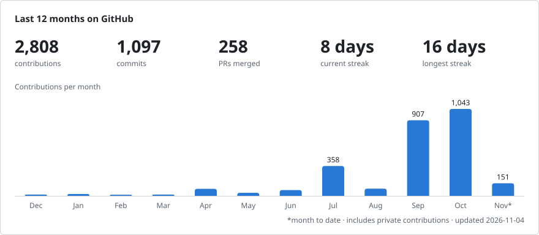
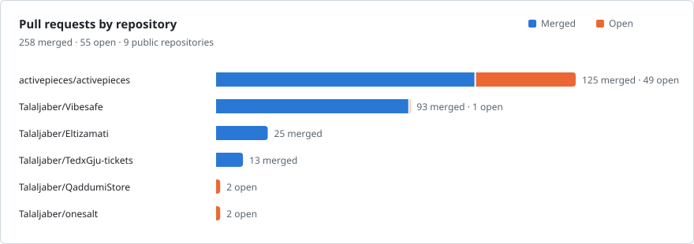

<picture>
  <source media="(prefers-color-scheme: dark)" srcset="assets/header-dark.svg">
  
</picture>

  

I build production software and the AI systems that run inside it: LLM-powered actions, developer tooling for AI-built code, and applied ML models trained on real-world signals. I work on AI and integrations at [Activepieces](https://www.activepieces.com), an open-source automation platform, and I lead engineering at [DineLink](https://dinelink.org), the restaurant platform I founded.

<table>
<tr>
<th align="left" width="50%">Software engineering</th>
<th align="left" width="50%">AI engineering</th>
</tr>
<tr>
<td valign="top">

- Production platforms built end to end, from customer discovery to deployment
- Real-time systems: kitchen sync for restaurants, one-scan QR validation
- Multi-package developer tooling: shared core, CLI, VS Code extension and MCP server
- 9+ client applications shipped as a freelance engineer

</td>
<td valign="top">

- AI actions and LLM integrations, including OpenAI and Claude, at Activepieces
- AI-powered ordering in production at DineLink
- Applied ML: acoustic leak detection and real-time driver drowsiness detection
- Safety tooling for AI-generated code: secrets, unsafe config, pre-deploy checks

</td>
</tr>
</table>

## Experience

| Company | Role | Since | Focus |
|:--|:--|:--|:--|
|  **[Activepieces](https://www.activepieces.com)** | Software Engineer | Sep 2026 | AI actions, output schemas and step UI for an open-source workflow automation platform. <!-- AP_MERGED:START -->125<!-- AP_MERGED:END --> merged pull requests across <!-- AP_PIECES:START -->88<!-- AP_PIECES:END --> integrations, including Gmail, Slack, HubSpot, OpenAI and Claude |
|  **[DineLink](https://dinelink.org)** | Founder & CTO | Feb 2025 | AI-powered ordering and real-time kitchen sync for restaurants. Phase Two of the DITECH Incubation Hub |
| **[Mawa3eed](https://mawa3eed.org)** | Founder | Aug 2026 | Appointment booking through a WhatsApp link, with no app or account. Piloting with 4 salons |
| **Alfredo EdTech** | Software Engineering Intern | Aug 2026 | Internal automation tooling and an automated social media pipeline |
| **Freelance** | Full-Stack Engineer | Feb 2025 | 9+ web applications for small businesses, from discovery to deployment |

## Selected work

**AI and machine learning**

| Project | Summary | Result |
|:--|:--|:--|
| **[VibeSafe](https://github.com/Talaljaber/Vibesafe)** | Pre-deploy safety scanner for AI-built apps that catches leaked secrets and unsafe config. TypeScript monorepo with a shared core, CLI, VS Code extension and MCP server |   |
| **[HydroSense](https://github.com/Talaljaber/HydroSense)** | Pipe leak detection from acoustic sensor data, using DSP feature extraction and an ExtraTrees classifier | 93.4% test accuracy · accepted to ICFT 2026 |
| **[Driver Monitor](https://github.com/Talaljaber/driving-monitor)** | Real-time drowsiness detection from MediaPipe face landmarks, with signal smoothing and a three-state alert engine | Webcam-based, with an optional ONNX signal model |

**Product engineering**

| Project | Summary | Result |
|:--|:--|:--|
| **[Eltizamati](https://github.com/Talaljaber/Eltizamati)** | Bilingual (Arabic/English) app for tracking loans, Murabaha financing and credit cards, built on a decimal-safe finance engine | 5th place, Rally Fintech Hackathon |
| **[MedModelle](https://medmodelle.com)** | E-commerce platform for medical apparel, delivered end to end for a client in Jordan | Live at [medmodelle.com](https://medmodelle.com) |
| **[TEDxGJU Tickets](https://github.com/Talaljaber/TedxGju-tickets)** | QR ticketing with one-scan validation, an admin dashboard and email delivery | 150+ registrations, no delays at the door |

## Recent open-source contributions

<!-- RECENT_PRS:START -->
- [feat(attack): unauth-route check](https://github.com/Talaljaber/Vibesafe/pull/146) Vibesafe · Oct 30
- [feat(attack): idor check](https://github.com/Talaljaber/Vibesafe/pull/147) Vibesafe · Oct 30
- [feat(attack): HTML report with precision ledger](https://github.com/Talaljaber/Vibesafe/pull/140) Vibesafe · Oct 30
- [feat(attack): agent markdown report, terminal summary and curl lines](https://github.com/Talaljaber/Vibesafe/pull/143) Vibesafe · Oct 30
- [feat(attack): sessions and attack.json loaders](https://github.com/Talaljaber/Vibesafe/pull/144) Vibesafe · Oct 30
- [feat(attack): stable ids, persistence, baseline protection and retest diff](https://github.com/Talaljaber/Vibesafe/pull/139) Vibesafe · Oct 30
<!-- RECENT_PRS:END -->

## Activity

<picture>
  <source media="(prefers-color-scheme: dark)" srcset="assets/overview-dark.svg">
  
</picture>

<picture>
  <source media="(prefers-color-scheme: dark)" srcset="assets/prs-dark.svg">
  
</picture>

Regenerated daily by a GitHub Action from the GitHub API ([source](scripts/build-profile.mjs)).

## Recognition

- **Winner, Falling Walls Lab Jordan 2025** (DAAD) with DineLink, and **Global Finalist** in Berlin: one of the Top 100 selected from 2,750+ applicants, and the youngest finalist
- **Research:** co-author of HydroSense, low-cost leak detection with AI and IoT, accepted to ICFT 2026
- **Speaker** at the Eighth Arab Youth Conference, one of 8 representatives selected from GJU
- **Winner**, The Business Game (TTi) · **Finalist**, Queen Rania National Entrepreneurship Competition, National Technology Parade and GJU 3030 Innovation
- **Community:** Technical Lead at GDG Amman (3,000+ members) · Falling Walls Ambassador for Jordan
